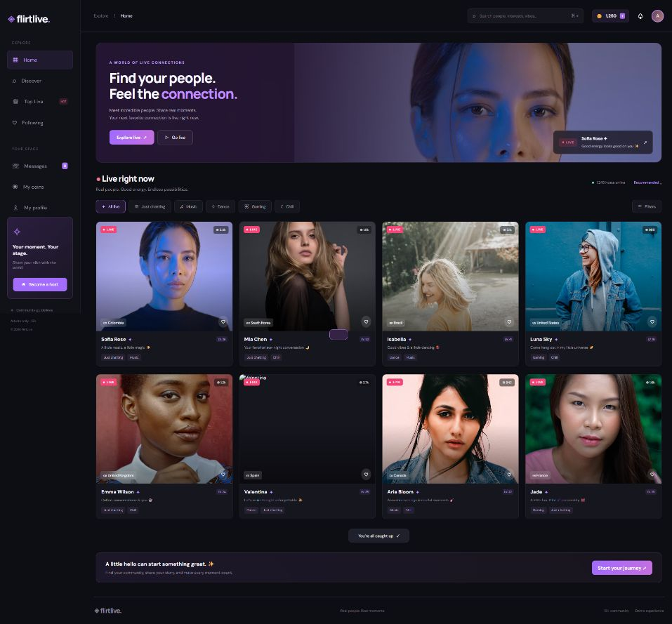

# FlirtLive

**Find your people. Feel the connection.**

FlirtLive is a premium live social streaming **front-end prototype** for an adults-only community. It combines creator discovery, a live room interface, local chat, virtual gifts, a demo coin wallet, follows, leaderboards, and profile editing in a responsive dark navy interface with purple and pink accents.



## Project status

This is an interactive browser demo, not an operational webcam service. Host identities, viewer counts, rankings, messages, and stream status are sample data. Room backgrounds are still portraits, not live video. The pictured models are stock-photo subjects and are not represented as actual platform hosts. No explicit content is included.

The private hosted preview is available to its owner at [FlirtLive preview](https://flirtlive-social-lounge.adam-vamshikrishna.chatgpt.site). Public repository access does not grant access to that private preview.

## Features

| Area | Current experience |
| --- | --- |
| Home | Featured hero, host cards, live badges, country labels, categories, and sample viewer counts |
| Discover | Search hosts by name, country, and interests; category and country filtering |
| Live room | Portrait stage, host information, follow action, share action, and local chat composition |
| Virtual gifts | Rose, Love, Diamond, Teddy Bear, Crown, and Rocket; sending deducts demo coins |
| Coin wallet | Starting balance of 1,250 test coins; simulated package top-ups without payment |
| Following | Follow/unfollow hosts and browse saved favorites |
| Top Live | Sample weekly rankings and a top-three podium |
| Messages | Sample creator invitations linking to their rooms; not private messaging |
| Profile | Editable display name and bio, local profile-photo upload, following and gifting stats |
| Host onboarding | Interest dialog saved on the current device; no camera capture or broadcast |
| Responsive UI | Sidebar navigation, mobile layouts, gradients, translucent panels, and hover transitions |

## Run locally

No package installation, API key, or build step is required. Install Python 3 and serve the static files:

```sh
git clone https://github.com/vams2krish/FlirtLive.git
cd FlirtLive
python -m http.server 4173 --directory dist
```

Open [http://localhost:4173](http://localhost:4173). Stop the server with `Ctrl+C`.

Alternatively, use any static HTTP server with `dist/` as the document root. Deploy that same directory to a static hosting provider.

## Pages and routes

| Route | Page |
| --- | --- |
| `#home` | Featured content and live host grid |
| `#discover` | Host browser |
| `#room/1` | Example host room; IDs 1–8 are available |
| `#following` | Saved follows |
| `#top` | Leaderboard |
| `#coins` | Demo wallet and gift catalog |
| `#messages` | Sample invitations |
| `#profile` | Profile editor |

Navigation uses URL hashes, so a static server needs no route rewrites. Press `Ctrl+K` or `Cmd+K` to focus search.

## Technology and structure

- Semantic HTML, CSS, and vanilla JavaScript; no application framework or build dependencies.
- CSS Grid/Flexbox, responsive media queries, and Google Fonts (DM Sans and Manrope).
- Sample portraits loaded from Unsplash image URLs.
- Browser `localStorage` for demo preferences and wallet/profile state.

```text
FlirtLive/
├── dist/
│   ├── index.html          # Application shell and navigation
│   ├── style.css           # Theme, components, and responsive styles
│   └── app.js              # Demo data, routing, rendering, and interactions
├── flirtlive-home.png       # Project screenshot


├── .gitignore
└── README.md
```

## Data behavior and limitations

The `flirtlive` localStorage entry stores the coin balance, following list, profile name/bio/avatar, and coins gifted. The separate `hostInterest` entry stores hosting interest. These values belong to one browser on one device; they are not synchronized, authenticated, or tamper-resistant. Clear those entries to reset the demo. Room chat messages are transient and disappear when the room is rendered again or the page reloads. Do not use the demo for sensitive information or real monetary balances.

Photo uploads accept image files up to 2 MB and store them locally. Large images can exceed browser storage quotas. External images and fonts require an internet connection. Profile XP and level indicators are illustrative, not a progression engine.

## Production roadmap

To turn this interface into an operational platform, the remaining work includes:

1. Authentication, account recovery, persistent user profiles, and authorization.
2. A real streaming provider/WebRTC implementation, host publishing, viewer playback, and presence.
3. Shared room chat and private messaging with server persistence and abuse controls.
4. Server-authoritative wallet accounting, payment processing, gift transactions, refunds, and creator payouts.
5. Age and creator identity verification, consent workflows, moderation, reporting/blocking, and operational policies appropriate to the intended service.
6. Real discovery, rankings, follow counts, media storage, analytics, and administration.
7. Automated tests, accessibility review, performance work, deployment configuration, monitoring, and security review.

The current browser demo has no backend, database, payment integration, streaming service, or real age-verification mechanism. An “18+” label is not verification.

## Validation

The JavaScript was checked with `node --check dist/app.js`. Home and room rendering were checked in a browser during the prototype build. This repository does not yet contain an automated test suite.

## Images and licensing

The screenshot documents this project's interface. Portrait imagery is loaded from Unsplash; the source image identifiers are listed in `dist/app.js`. Review the applicable image terms and replace placeholder assets before production use. Third-party imagery and fonts retain their respective rights. No open-source software license has been selected for this repository.
